# Lab 3: REST API, Query Parameters, Validation & Debugging

A complete Books REST API built with Node.js, Express.js and SQLite.

- **Name:** Veera Dharan Sri Datta
- **Class:** CSE-FSD-2B
- **Registration Number:** 252U1R7096
- **Faculty Name:** Joel Prasanth


## 1. Requirements

- Node.js 18 or later
- npm
- Postman (for API testing)

## 2. Setup

Open a terminal in this project folder and run:

```bash
npm install
npm start
```

The API runs at `http://localhost:3000`. The SQLite database (`books.db`) is created automatically and sample records are inserted on first run.

To use another port on Windows PowerShell:

```powershell
$env:PORT=3001; npm start
```

On macOS/Linux:

```bash
PORT=3001 npm start
```

## 3. Endpoints

| Method | Endpoint | Purpose | Success status |
|---|---|---|---|
| GET | `/books` | List, search, sort, filter and paginate | 200 |
| GET | `/books/:id` | Get one book | 200 |
| POST | `/books` | Create a book | 201 |
| PUT | `/books/:id` | Update a book | 200 |
| DELETE | `/books/:id` | Delete a book | 200 |

All error responses use the consistent JSON shape:

```json
{ "message": "A clear explanation of the error" }
```

## 4. GET /books query parameters

All parameters are optional and have defaults.

| Parameter | Default | Description |
|---|---|---|
| `search_q` | empty string | Partial title search |
| `order_by` | `title` | Sort column: `id`, `title`, `author`, `price`, `created_at` |
| `order` | `ASC` | Sort direction: `ASC` or `DESC` |
| `limit` | `10` | Maximum number of records |
| `offset` | `0` | Number of records to skip |
| `min_price` | not applied | Minimum price, inclusive |
| `max_price` | not applied | Maximum price, inclusive |

Examples:

```text
GET http://localhost:3000/books
GET http://localhost:3000/books?search_q=fire
GET http://localhost:3000/books?order_by=price&order=DESC
GET http://localhost:3000/books?limit=5&offset=0
GET http://localhost:3000/books?min_price=200&max_price=400
GET http://localhost:3000/books?search_q=the&order_by=title&order=ASC&limit=5&offset=0&min_price=100&max_price=500
```

The search uses SQL `LIKE` with a parameterized value. Sorting columns are checked against an allow-list because SQL identifiers cannot be supplied as query parameters. All user-provided values are parameterized.

## 5. Request body examples

### Create - POST /books

```json
{
  "title": "Clean Code",
  "author": "Robert C. Martin",
  "price": 550
}
```

### Update - PUT /books/1

```json
{
  "title": "Updated Book Title",
  "author": "Updated Author",
  "price": 399
}
```

The API rejects missing/blank title, missing/blank author, missing price, non-numeric price and negative price with HTTP 400.

## 6. Expected status codes

- `200 OK`: successful GET, update or delete.
- `201 Created`: successful book creation.
- `400 Bad Request`: invalid input or invalid query parameters.
- `404 Not Found`: requested book ID or endpoint does not exist.
- `500 Internal Server Error`: unexpected server/database failure.

## 7. Debugging exercise

1. **EADDRINUSE (port conflict):** Another process is using port 3000. Stop that process or run the app on another port using the `PORT` environment variable. Do not start multiple server instances on the same port.
2. **Wrong import path:** Check the relative path and filename. For example, from `src/routes/books.js`, the database import is `require("../database")`.
3. **No such table:** Ensure the database initialization runs before the server accepts requests. Use the correct table name `books` consistently.
4. **Missing await:** Await asynchronous database operations before using their results or sending the response. This project uses `await` for database calls and awaits initialization before listening.

## Screenshots
1.	Name the endpoints as nouns (/books) and use the HTTP method to show the action.
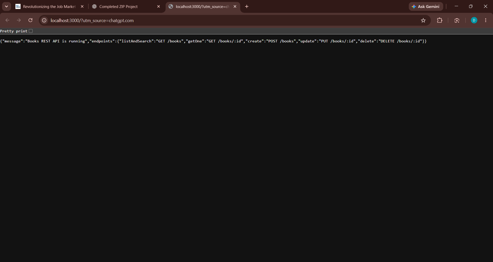
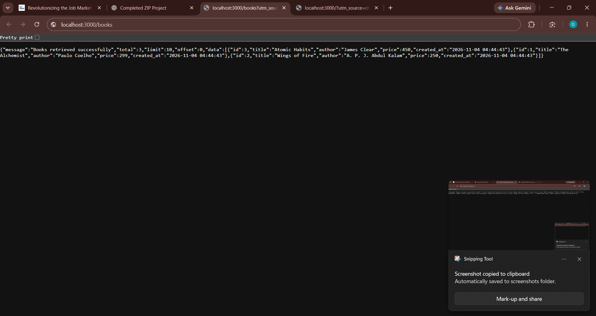
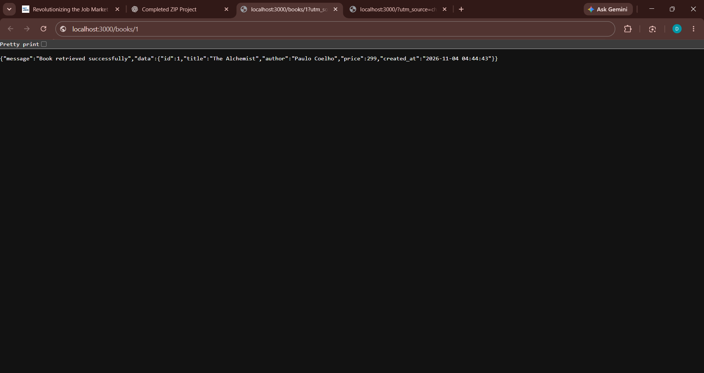


2.	Add query parameters to GET /books/: search_q (partial title match with LIKE), order_by, order (ASC/DESC), limit and offset, each with a default value.

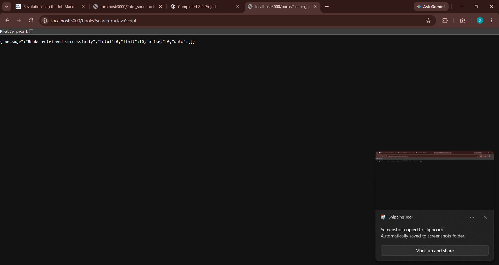
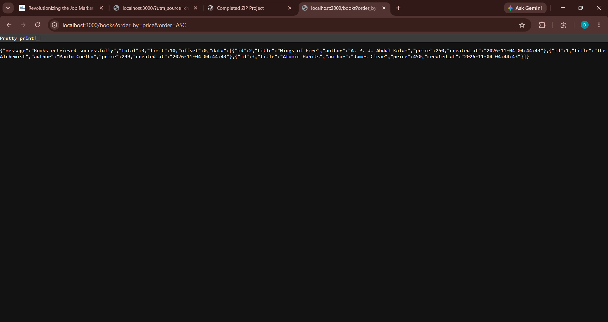


3.	Add a price-range filter, for example min_price and max_price using BETWEEN or two conditions.


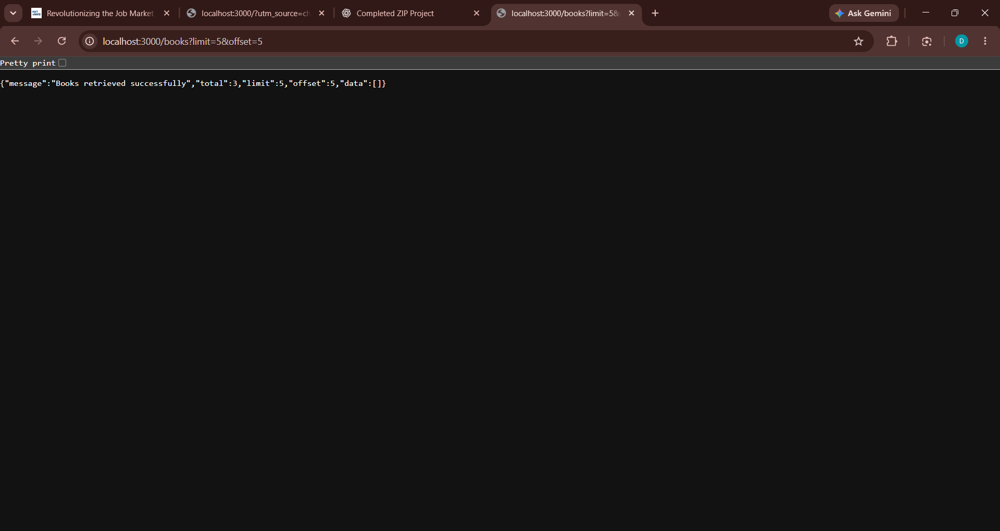


4.	Validate the POST body: reject missing title, author or a non-numeric price with 400 and a clear JSON message.
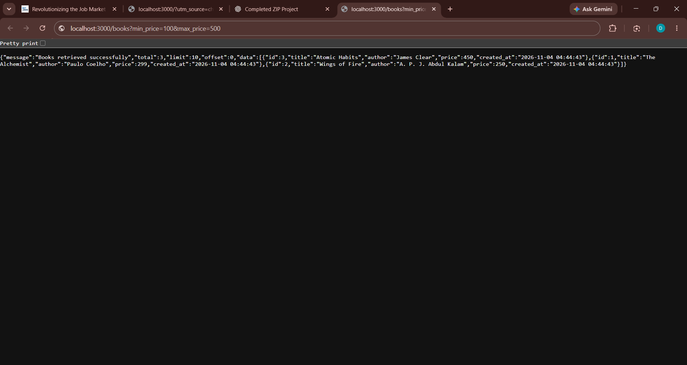

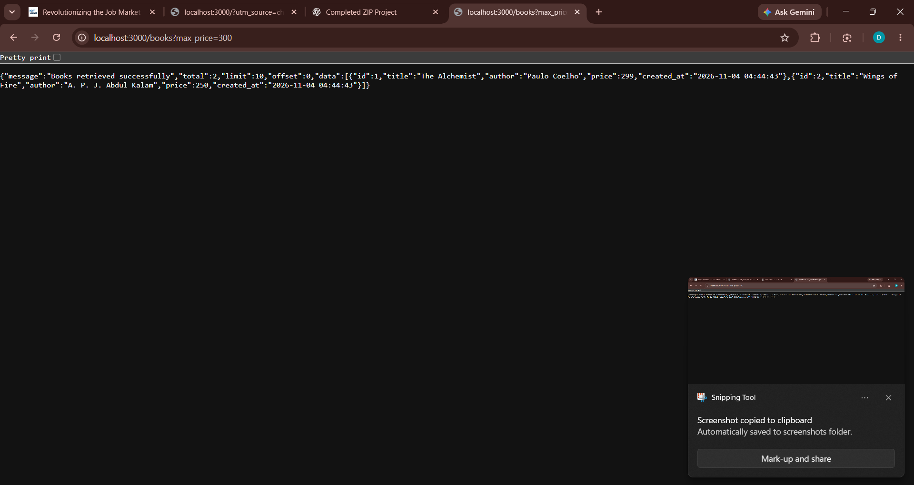


5.	Return 201 after create, 200 after update and delete, and 404 when the id does not exist.

To create:
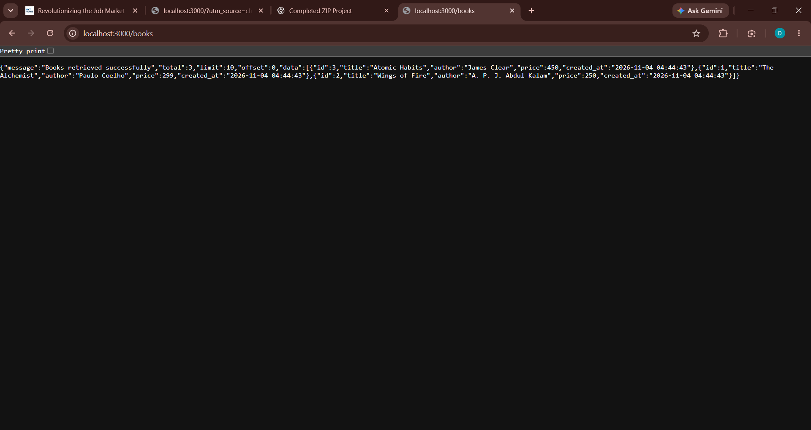

To update and delete:
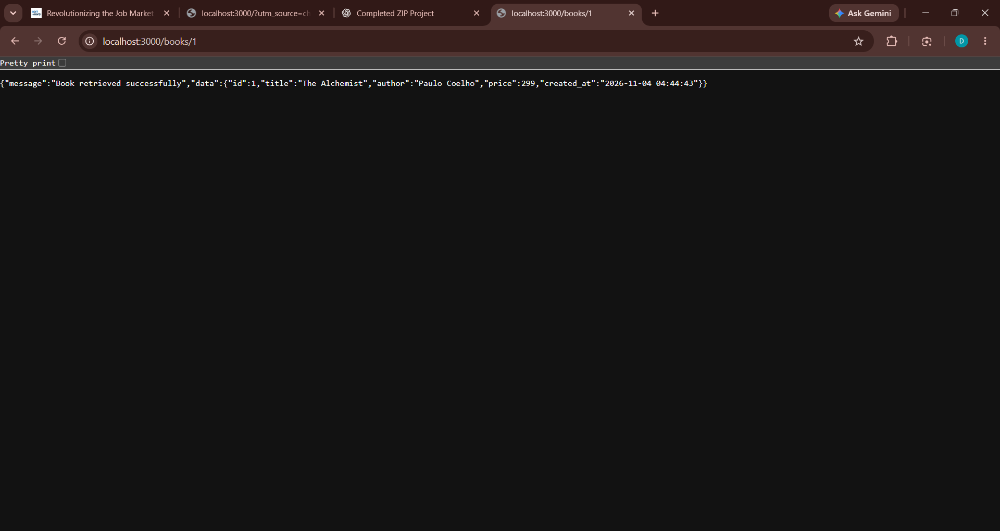

To update missing id and delete missing id:
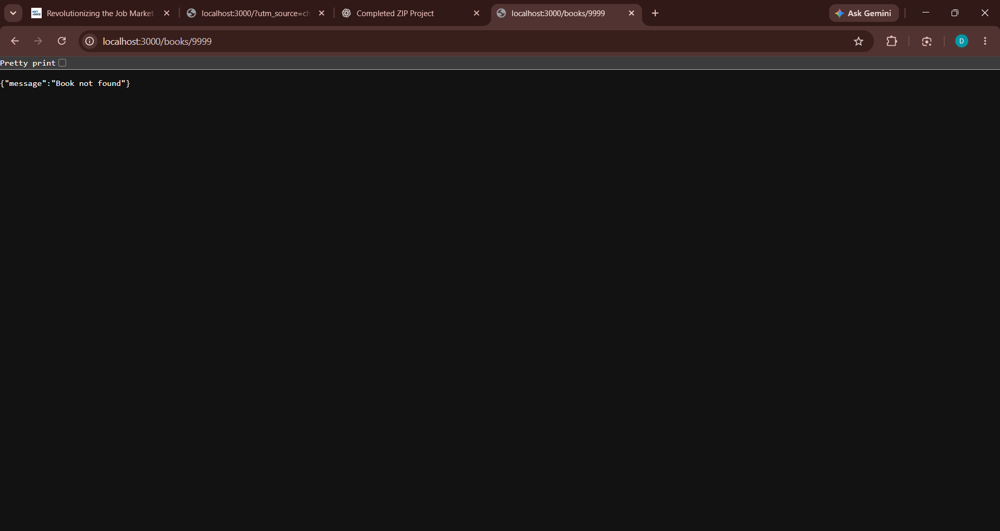


6.	Make the response format consistent, for example { "message": "..." } for errors.
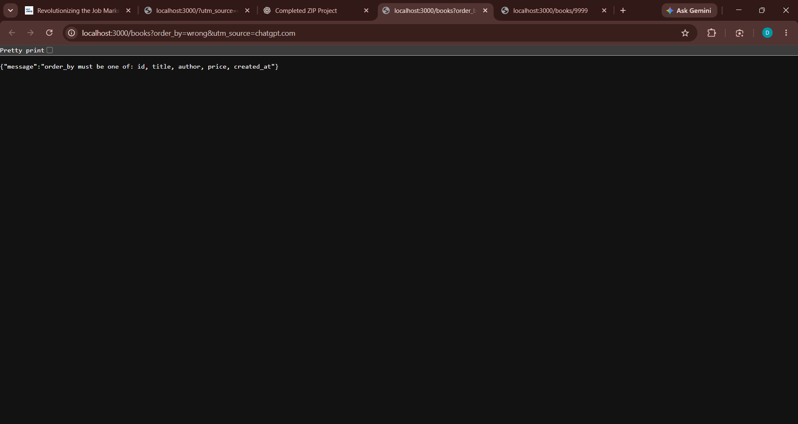

7.	Debugging exercise: the faculty hands out a broken version of the project. Students fix a port conflict (EADDRINUSE), a wrong import path, a table-name typo (no such table) and a missing await.
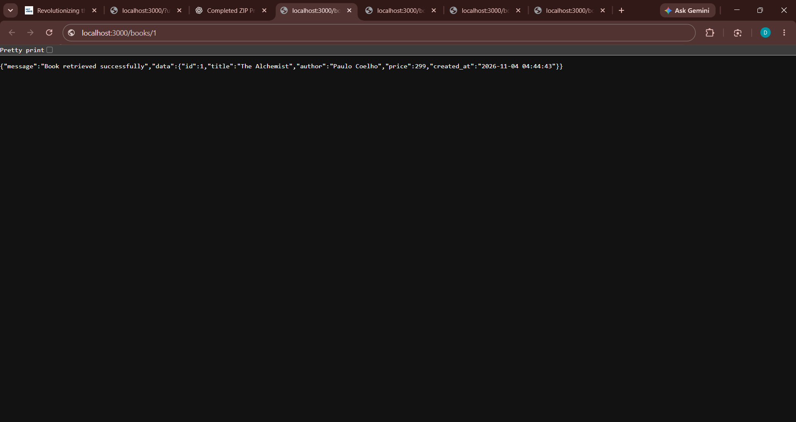


## 8. Viva answers

**Q1. Query parameter vs path parameter?**  
A path parameter identifies a particular resource, such as `/books/5`. A query parameter modifies or filters a request, such as `/books?search_q=fire`.

**Q2. What does stateless mean?**  
Each HTTP request contains the information needed to process it. The server does not rely on stored session state from a previous request to understand the current request.

**Q3. Which status code for bad input vs a missing record?**  
Use `400 Bad Request` for invalid input and `404 Not Found` when the requested record does not exist.

## 9. Submission contents

- `server.js` - starts the server after database initialization.
- `src/database.js` - SQLite connection and database helper functions.
- `src/routes/books.js` - CRUD routes, query parameters and validation.
- `src/app.js` - Express application and error handling.
- `postman/Lab_03_Books_API.postman_collection.json` - API test collection.
- `postman/POSTMAN_TEST_CHECKLIST.md` - success and failure test checklist.

No `.env` file or `node_modules` folder is included.
